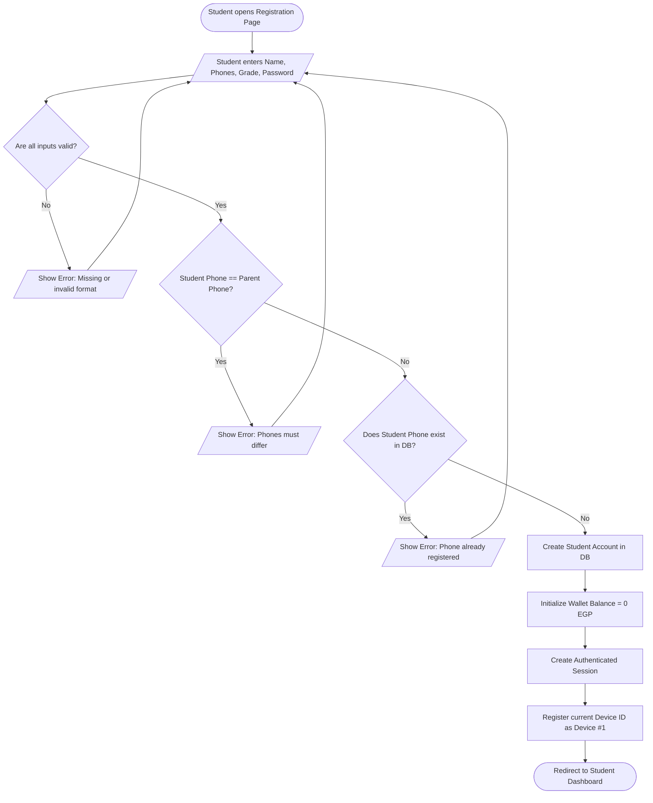
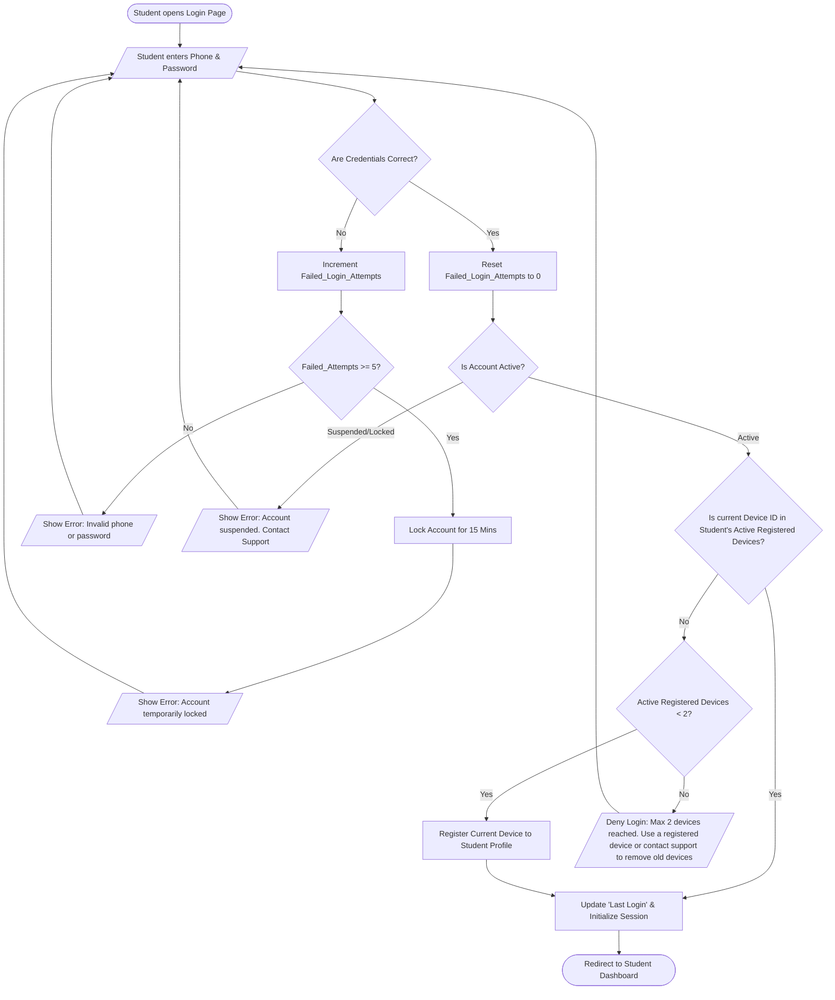
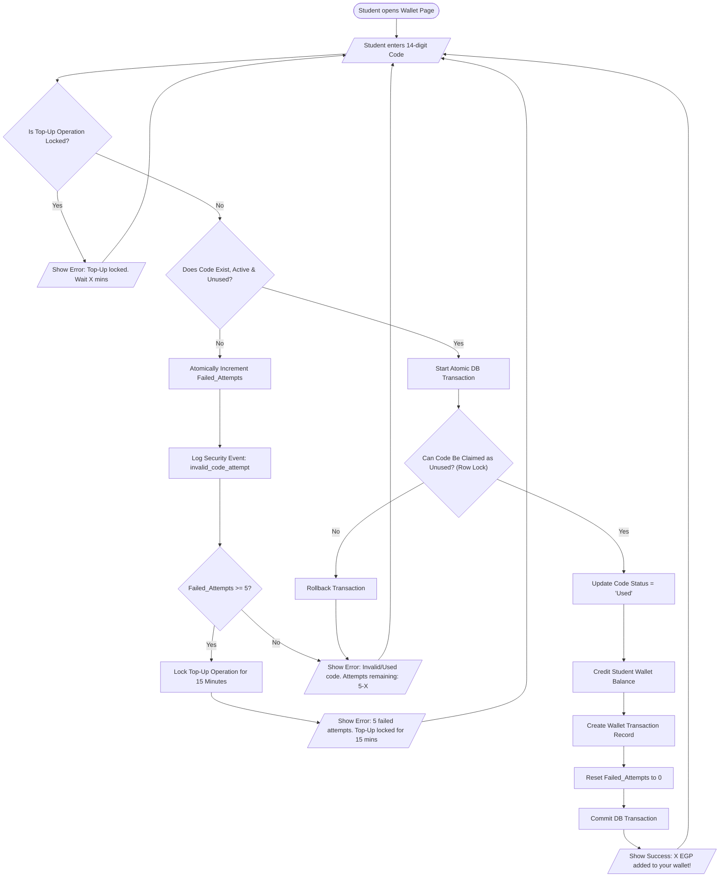
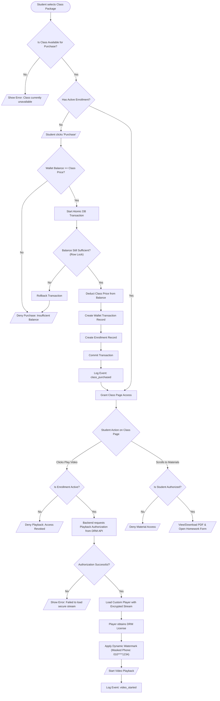
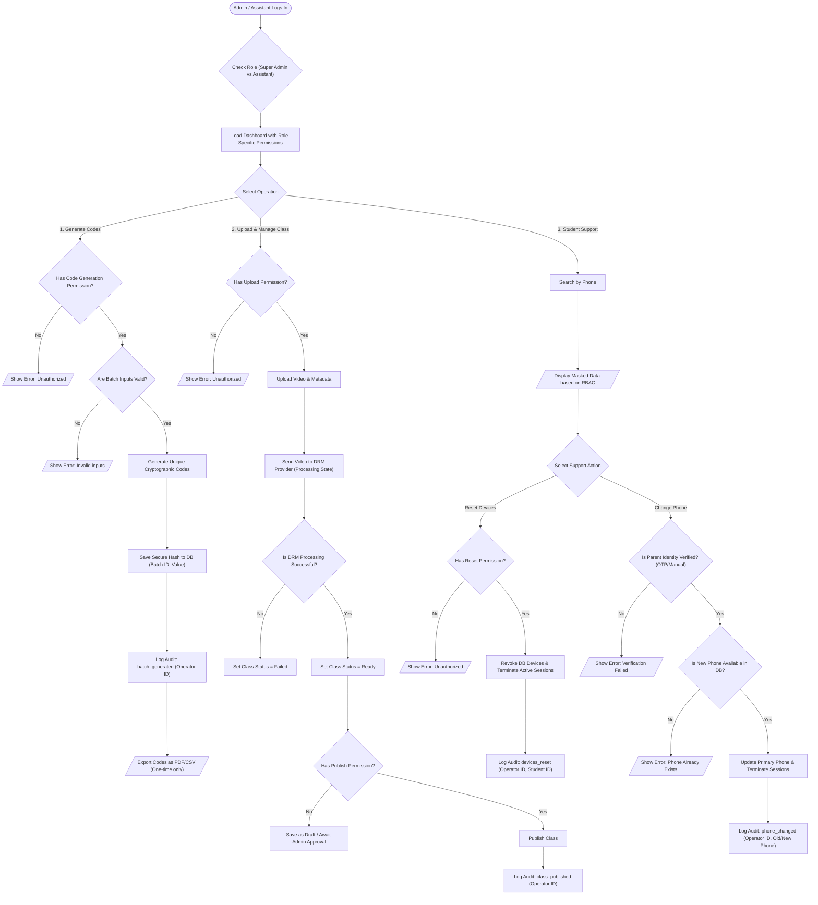

# ***Flow Diagrams***

### 1- Registration & Onboarding Flow:



---

### 2- Login & Anti-Sharing Device Limit Flow



---

### **3- Wallet Top-Up & Brute-Force Protection Flow**



---

### Class Purchase & DRM Playback Flow



---

### **Admin & Assistant Operations Flow (RBAC & Audit-Ready)**



---

# ***WireFrames***

### Registration & Login Screen

```
+-------------------------------------------------------------------+
|  [Platform Logo]                                [Login] [Register]|
+-------------------------------------------------------------------+
|   CREATE NEW ACCOUNT (Registration Flow)                          |
|   -------------------------------------------------------------   |
|   Full Name *                                                     |
|   [ e.g., Ahmed Mohamed Ali                                   ]   |
|                                                                   |
|   Student Phone (Primary ID) *      Parent Phone *                |
|   [ 010XXXXXXXX              ]      [ 012XXXXXXXX             ]   |
|                                                                   |
|   Grade Level *                                                   |
|   [ Dropdown: 1st Sec / 2nd Sec / 3rd Sec v                   ]   |
|                                                                   |
|   Password *                                                      |
|   [ ****************                                          ]   |
|                                                                   |
|   [                      Create Account                       ]   |
|                                                                   |
|   ⚠️ Validation Messages:                                         |
|   - Err 1: "Student and Parent phones must differ."               |
|   - Err 2: "This phone number is already registered."             |
+-------------------------------------------------------------------+
```

---

### Student Dashboard & Class Catalog

```
+-------------------------------------------------------------------+
|  [Logo]   📚 My Classes   💳 Wallet (150 EGP)   [👤 Ahmed (3rd Sec)]|
+-------------------------------------------------------------------+
|  AVAILABLE CLASSES - MR. M.A (PHYSICS)                            |
|  Filter by Chapter: [ All Chapters v ]                            |
|                                                                   |
|  +-----------------------------+  +-----------------------------+ |
|  | [Thumbnail: Chapter 1]      |  | [Thumbnail: Chapter 2]      | |
|  | Lecture 1: Ohm's Law        |  | Lecture 2: Kirchhoff's Law  | |
|  | Status: ✅ ACTIVE ENROLLMENT|  | Status: 🛒 AVAILABLE        | |
|  |                             |  | Price: 80 EGP               | |
|  | [     ▶️ Watch Now      ]   |  | [   🔒 Purchase (80 EGP)  ] | |
|  +-----------------------------+  +-----------------------------+ |
|                                                                   |
|  +-----------------------------+                                  |
|  | [Thumbnail: Chapter 3]      |  ⚠️ Conditional Purchase Modal:  |
|  | Lecture 3: Magnetism        |  "Deduct 80 EGP? (Balance: 150)" |
|  | Status: ⏳ UNAVAILABLE      |  [ Cancel ] [ Confirm Purchase ] |
|  | (Coming Soon)               |  (Triggers Atomic DB Tx)         |
|  | [ 🚫 Purchase Disabled  ]   |                                  |
|  +-----------------------------+                                  |
+-------------------------------------------------------------------+
```

---

### Student Wallet & Top-Up

```
+-------------------------------------------------------------------+
|  [Logo]   📚 My Classes   💳 Wallet (150 EGP)   [👤 Ahmed]         |
+-------------------------------------------------------------------+
|   💰 CURRENT WALLET BALANCE: 150.00 EGP                           |
|                                                                   |
|   +-----------------------------------------------------------+   |
|   | REDEEM SCRATCH CODE (Top-Up Operation)                    |   |
|   | Enter the 14-digit code: [  XXXX-XXXX-XXXX-XX  ]          |   |
|   |                                                           |   |
|   | [     Redeem Code     ]                                   |   |
|   |                                                           |   |
|   | ⚠️ Top-Up States (BR-W05 / BR-W08):                       |   |
|   | - Success: "✅ 100 EGP added! (Failed attempts reset to 0)" |   |
|   | - Invalid: "❌ Invalid/Used code. (2/5 tries remaining)"    |   |
|   | - Locked:  "🔒 Top-Up operation is locked for 14:32 mins  |   |
|   |             due to multiple failed attempts."             |   |
|   +-----------------------------------------------------------+   |
|                                                                   |
|   📜 WALLET TRANSACTION RECORD (Financial Audit)                  |
|   25/10/2026 | Purchased: Lecture 1           | -80 EGP           |
|   25/10/2026 | Code Top-Up (Ref: ****4591)    | +100 EGP          |
+-------------------------------------------------------------------+
```

---

### DRM Video Player & Materials

```
+-------------------------------------------------------------------+
|  < Back to Dashboard                                     [👤 Ahmed] |
+-------------------------------------------------------------------+
|  Lecture 1: Ohm's Law & Electrical Resistance                     |
|                                                                   |
|  +-------------------------------------------------------------+  |
|  |  [🔒 DRM-Protected Stream (Active Auth Token)]              |  |
|  |                                                             |  |
|  |         (Dynamic Watermark: Student ID - 010****1234)       |  |
|  |                                                             |  |
|  |  [00:14:22 / 01:45:00]              [Speed: 1.5x] [1080p]   |  |
|  +-------------------------------------------------------------+  |
|  * If Authorization Fails: [🚫 Playback Access Denied]            |
|                                                                   |
|  📂 ATTACHED CLASS MATERIALS (Independent Entitlement Checks)     |
|  +-------------------------------------------------------------+  |
|  | 📄 Lecture 1 Summary (View Only)         [ 👁️ View PDF     ]|  |
|  | 📝 Lecture 1 Mandatory Homework          [ 🔗 Open Form    ]|  |
|  | 🧪 Weekly Timed Quiz (30 Mins)           [ ⏱️ Start Quiz   ]|  |
|  +-------------------------------------------------------------+  |
+-------------------------------------------------------------------+
```

---

### Admin & Assistant RBAC Portal

```
+-----------------------------------------------------------------------+
|  [Portal] Role: [Assistant_Omar] | Permissions: Restricted   [Logout] |
+-----------------------------------------------------------------------+
|                                                                       |
|  SECTION A: CLASS UPLOAD & PUBLISHING (Processing States)             |
|  Class: [ Lecture 2 ]   Price: [ 80 EGP ]   Grade: [ 3rd Sec ]        |
|  Video: [📤 Upload] --> State: 🔄 PROCESSING (Encrypting via DRM...)  |
|  [ 💾 Save as Draft (Ready) ]  [ 🚀 Publish (Super Admin Only) 🔒 ]   |
|                                                                       |
|  -------------------------------------------------------------------  |
|  SECTION B: SECURE CODE GENERATION (RBAC Applied)                     |
|  Value: [100 EGP] Quantity: [50]   [ ⚡ Generate Cryptographic Batch ]  |
|  Export Options: [ 📥 Export CSV (Allowed ONCE) ]                     |
|  * Super Admin Only: [ Revoke Unused Batch 🔒 ]                       |
|                                                                       |
|  -------------------------------------------------------------------  |
|  SECTION C: STUDENT SUPPORT & AUDIT-READY ACTIONS                     |
|  Lookup: [ 01012345678 ] [🔍 Search]                                  |
|                                                                       |
|  👤 PROFILE (Masked Data via Least Privilege):                        |
|  Name: Ahmed M. ***                 Parent Phone: 012****5432         |
|  Wallet: 70 EGP                     Status: ✅ Active                 |
|                                                                       |
|  🛠️ SUPPORT ACTIONS (Triggers Audit Logs):                            |
|  • Active Devices: 2/2                                                |
|    [ 🔄 Revoke Devices & Terminate Sessions ]                         |
|  • Phone Recovery (Requires Parent Verification):                     |
|    [ ✏️ Update Primary Phone (Super Admin Only) 🔒 ]                  |
|                                                                       |
|  -------------------------------------------------------------------  |
|  SECTION D: SYSTEM AUDIT LOGS (Append-Only / Viewable by Admin)       |
|  25/10 14:00 | batch_generated | Op_ID: Asst_Omar | Qty: 50           |
|  25/10 15:30 | devices_reset   | Op_ID: Admin_01  | Target: 010***12  |
|  25/10 16:00 | class_published | Op_ID: Admin_01  | Target: Class_02  |
+-----------------------------------------------------------------------+
```
